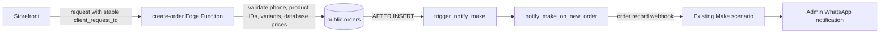

# Bokhoor storefront and order security review

## Production evidence (read-only)

- Supabase project `zhppvfabbjffmjgsiaza` is in `eu-west-1`.
- `public.products` contains 4 rows; the live schema has `id`, `title`, `price`, `badge`, `variants`, `stock_quantity`, and `min_limit_alert`, with no `is_published` column. All four `stock_quantity` values are 0; these values are not treated as real inventory by the storefront.
- `public.orders` contains 53 rows. It has no `client_request_id` or `order_items` columns.
- No Supabase migrations are recorded and no Edge Functions are deployed.
- The live `trigger_notify_make` trigger runs after every insert on `public.orders`, calling `notify_make_on_new_order()`. That function is `SECURITY DEFINER` and currently has no pinned `search_path`; it sends the full inserted order record to a Make webhook embedded in the function. Do not disable it until a replacement is verified and approved. Rotate the old webhook URL before a future cutover.
- The live product policy allows public `ALL` operations; review/RLS tables also have overly broad exposure. `analytics` and `shares` have RLS disabled. These production policies were not changed.
- Backup restoreability, Make scenario settings, and message delivery logs were not available to verify. No live order or WhatsApp message was created.

## One notification route

The local Edge Function does not call Make or UltraMsg itself. The database trigger is the sole sender, so an idempotent retry that finds the same order does not create a second insert or trigger event. The browser neither decrements stock nor opens `wa.me`. Make-side deduplication and an authorized end-to-end delivery test are still required before claiming exactly-once delivery; the trigger's embedded webhook has not been rotated and Make history is unavailable.

## Local changes and gates

- The storefront product query uses existing columns and does not silently substitute fake products.
- Checkout validates inputs, calls the server function, and only displays success after it receives a saved `order_id`.
- Inventory checks and browser stock updates are removed. The checkout explains that the store will confirm availability.
- The Edge Function recomputes totals from the database and uses `client_request_id` for retry safety. Its required migration and function are not deployed.
- The active source no longer contains a direct UltraMsg sender or its retry/status migration.
- The additive migrations and code must be reviewed against a restorable backup before any production apply/deploy. The untracked local RLS proposal and tests are preserved and were not staged or modified.

## Remaining production risks

The live trigger function's unpinned search path and embedded webhook should be addressed in a reviewed migration after a backup is verified. Current public RLS policies expose write operations on products/reviews, and RLS is disabled for analytics/shares. They were deliberately not changed in this task because production policy changes require compatibility review and approval. The Make scenario's mapping, idempotency, retry behavior, callback, and message delivery cannot be confirmed without Make access.

## Rollback

Keep the current production deployment and legacy trigger active until the new Edge Function and frontend are verified. If an approved release fails, restore the last validated frontend/Edge Function versions while retaining all additive columns and existing rows. Never reset the database, delete records, or restore the exposed client-side webhook path.
