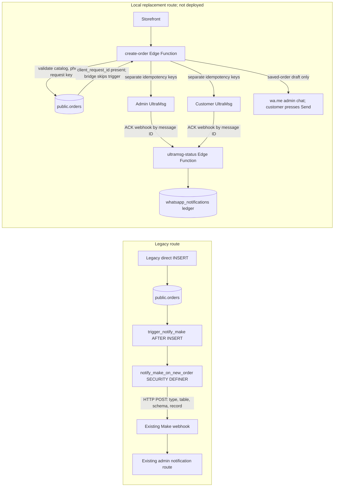

# Bokhoor order and notification security review

## Current production evidence (read-only inspection)

- Supabase project ref: `zhppvfabbjffmjgsiaza` (active, `eu-west-1`).
- `public.orders` has 53 rows and RLS enabled, but no row policies. `orders.id` is `bigint`; current customer and amount columns are nullable. `client_request_id` and `order_items` are absent.
- `public.products` has 4 rows, RLS enabled, and an `Allow public access to products` policy with command `ALL` and unconditional `USING`/`WITH CHECK`. All four live `stock_quantity` values are 0. The live schema has no `is_published` column.
- `public.reviews` has RLS enabled, but its existing public policy also permits every operation.
- `public.analytics` and `public.shares` have RLS disabled. Analytics stores IP addresses.
- `public.whatsapp_notifications` and the new order idempotency fields do not exist yet.
- The database has no recorded migrations or deployed Edge Functions, including `create-order`.
- A recent restorable backup could not be verified with the connected tools.
- No Make or UltraMsg account connection was available. No message was sent.

## Notification routes

The legacy trigger is `trigger_notify_make`, on `public.orders`, calling `public.notify_make_on_new_order()`. The function is `SECURITY DEFINER`, has no configured `search_path`, and was executable by `anon` and `authenticated`. Its URL is intentionally redacted. It POSTs JSON with keys `type`, `table`, `schema`, and `record`; `record` is the entire inserted order row and therefore includes customer information. The Make webhook URL remains embedded in the database function until it is rotated and replaced.

The current admin modal does not query `orders` or call the legacy function. It uses Supabase Auth and manages products/reviews plus analytics counts. The local checkout draft opens a prepared `wa.me` message to the manager only after the server confirms the saved order; the customer must press Send. The local `bokhoor/` page redirects to the main storefront. Recent Data API logs show GET `/rest/v1/products` requests returning HTTP 400 after the client began filtering on the nonexistent `is_published` column; unfiltered product GET requests returned HTTP 200.

## Staged cutover; no production changes applied

1. Rotate the old Make webhook URL and any exposed UltraMsg token. Configure Make's secured fields; do not paste tokens into source control or chat.
2. Repair the existing Make scenario rather than replacing its working admin module. Add separate recipient routes, recipient-specific Data Store keys, callbacks, and error handling. Validate each route with a non-sending sink first.
3. Verify a current restorable Supabase backup and validate the migrations against an isolated database.
4. Apply `20261114010000_whatsapp_notification_tracking.sql`, then `20261114015000_dual_order_notification_path.sql`. The bridge keeps the legacy notification for direct legacy inserts and skips rows with `client_request_id`, preventing two independent webhook deliveries for a new Edge Function order. It does not stop the old route.
5. Configure UltraMsg secrets and deploy/test `create-order`, `retry-notification`, and `ultramsg-status` in staging. Verify order creation, idempotency, separate recipient callbacks, explicit failures, and ambiguous outcomes with an authorized test number only.
6. Complete the server-side stock reservation before production RLS: the current browser still attempts to decrement product stock after checkout. The RLS proposal blocks that public update by design. Do not preserve that browser permission to keep stock working.
7. Publish the storefront that calls `create-order`; then apply the RLS migration in the approved window. Verify old-client traffic and successful admin notifications throughout.
8. After a soak period, confirm no legacy direct inserts remain and the new Make routes deliver admin alerts. Only then prepare a separate trigger-retirement migration and obtain approval. Never retire the bridge in the same unverified cutover.

Rollback before trigger retirement: restore only a previously validated storefront that calls a secured server endpoint; keep the bridge and additive records. After RLS is enabled, the former browser-direct order insert is intentionally blocked, so reverting to that legacy client is not a valid rollback. If no secure compatible artifact is available, hold the current release and ship a forward fix rather than reopening anonymous order writes. Do not restore the exposed client-side webhook. Trigger retirement is a separate approved action; its rollback is to recreate the legacy trigger only after the rotated endpoint is safely configured.

## RLS proposal

`20261114020000_rls_hardening.sql` is local only. It uses `auth.jwt()->'app_metadata'->>'role' = 'admin'` for manager access. Public users can read published products and reviews, add share/visitor events, but cannot read analytics/IPs, mutate products, read orders, or create orders directly. Authenticated non-admin customers have no order ownership mapping in this application, so they see no orders. Admin users may read orders, but this app has no order-management screen or order status column; direct browser changes to order totals remain prohibited. The service-role-backed Edge Function owns order creation.

The migration adds `products.is_published` defaulting existing products to published. Analytics IP uniqueness uses a unique index; if duplicates appear before rollout, index creation fails without deleting rows and must be reviewed. The migration has no DELETE or UPDATE of existing records. RLS is not applied until backend stock handling and deployed storefront behavior have been verified.

## Direct UltraMsg route (prepared locally, not configured)

`create-order` posts each recipient independently to UltraMsg's `messages/chat` endpoint using form-encoded `token`, `to`, and `body`, with the token read only from the server-side `ULTRAMSG_TOKEN` secret. Each recipient has a unique ledger row and idempotency key. Retry claims are limited to explicit, retryable provider rejections; ambiguous timeout outcomes are marked `unknown` and must be reconciled before resend. `ultramsg-status` accepts ACK callbacks by message ID and a high-entropy callback key; verify the actual callback payload against the account before enabling it. A 2xx response may mean queued/accepted and is not proof of device delivery.

The legacy Make trigger and scenario remain in production and have not been altered. The local bridge migration is required before new Edge Function inserts can bypass the legacy webhook, and should be tested before deployment to prevent two backend send paths. Make/UltraMsg credentials, live Make scenario, hosting configuration, and backup status were not available to verify. No account was modified.

## Local test

`supabase/tests/security_rls.sql` runs only against an isolated local/test database after the tracking, bridge, and RLS migrations. It wraps fixtures in a transaction and rolls back. It checks published vs draft visibility, order and analytics isolation, role-based product management, browser order-total protection, presence of the unique request index, independent notification statuses, duplicate idempotency-key protection, and trigger bridge configuration. It deliberately creates no order fixture, to avoid accidentally triggering a real Make webhook if run on the wrong target. It has not been executed because PostgreSQL/Supabase CLI and Deno are unavailable in this workspace.
